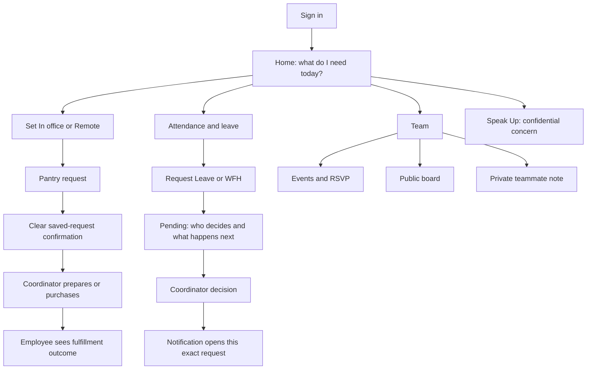

# Innovin Internal: information architecture and user-journey audit

> Historical baseline before the repair branch. See [repair dispositions and current verification](2026-10-27-user-journey-repairs.md). Counts below describe the original sampled states, not the repaired build.

**Baseline verdict: not ready to call the employee journey seamless.** The important actions mostly have working destinations and saved outcomes. The larger problem is that similar-looking actions have different meanings, and some labels promise a result the action does not produce. An employee can use it, but must learn the implementation's distinctions: a plan versus a request, a tray versus a purchase, and an edited step count versus a saved count.

This is a product-experience review, not a test-pass report. No product code was changed.

## Scope and evidence

- Revision: `cd1c268`, branch `pantry-provider-integration`. This is the pushed checkout, not proof of a merged or deployed version.
- All 13 page routes, shared navigation, nested composers/dialogs, role-dependent admin surfaces and recovery controls were accounted for in source. Three layouts and two error pages are additional entry modules.
- Opened and counted 44 distinct screen/state combinations in a dedicated local fixture copy: desktop 1440px and mobile 390px. Fake Google identities, sample content, temporary file storage and the local Swiggy fixture were used. No real supplier purchase was placed by this audit.
- Three misleading/broken journeys were reproduced and recorded in [behavior observations](2026-10-27-journey-behavior-observations.json).
- [Rendered inventory](2026-10-27-rendered-control-inventory.json) records each visible button, link, disclosure, editable field, disabled state and whether it belongs to the shell, content or dialog. [Source inventory](2026-10-27-clickable-source-inventory.json) records action/field sites, handlers and destinations. Generated primitives and repeated data rows mean source-site totals are not screen-button totals.
- All 27 API route files / 54 exported HTTP handlers were enumerated and mapped to consumers below. This was not a fresh deep security audit of every handler branch.
- Existing `PRODUCT.md` changes and the PDF were preserved. Report files are local; nothing was committed, pushed, merged or deployed for this audit.
- An occupied local preview port was detected; counts from that preview were discarded. The retained measurements use the dedicated audit copy on port 33283.

## 1. The information architecture that exists today

```text
Signed out
└─ Google sign-in + interactive ID-card preview

Employee workspace
├─ Overview /
│  ├─ Digital pass → flip to personal calendar; copy email; edit profile
│  ├─ Presence → In office / Remote / Check out
│  ├─ Leave balance chips → Attendance (initial Today tab)
│  ├─ People in Office → arena/list/filter/wave/status
│  ├─ Office Notice Board → read/filter/react/post
│  ├─ Pantry → automatically saved internal tray
│  ├─ Events → create / RSVP
│  └─ Paper note → one teammate privately OR whole team publicly
├─ Daily Steps & Prize /steps
│  └─ Manual daily count + four ranking views
├─ Leave & WFH Planner /planner
│  └─ PRIVATE personal calendar, not approval requests
├─ Attendance /attendance
│  ├─ Today → check in/out
│  ├─ Calendar → recorded attendance, approved leave, holidays
│  └─ Leave → balances + actual local Leave/WFH requests + cancellation
├─ Meals & Snacks /snacks
│  ├─ Today → select, write instructions, explicitly Place/Update order
│  └─ History → internal selections
├─ People /people → directory, inbox, private ping/reply
├─ Events /events → event details and Join/Going toggle
├─ Speak Up /grievances → anonymous/named concern + own-device status
├─ Wi-Fi /wifi → measure speed, submit Good/Poor report
├─ Settings /settings → Google identity, sign out, Admin link
└─ Help /help → static explanations

Coordinator /admin
├─ Today → attendance, internal demand and Wi-Fi reports
├─ Approvals → local Leave/WFH decisions and Speak Up status
├─ People → manual Zoho snapshots, joining dates, fitness offsets
│  └─ Owner/PIN access → grant/revoke admin
├─ Publish → announcement/event creation and deletion
└─ Purchasing /admin/pantry
   └─ connect Instamart → address → variants → bill → confirmed COD order
```

Mobile changes the navigation, not just the layout: Home is a wallet of collapsed cards; Board is a local tab with no dedicated URL; Steps has its own route; Note opens a dialog. Attendance, directory, Wi-Fi, Help and Admin are farther down the wallet. There is no desktop Phone View toggle in the active portal.

`/leave` and `/away` redirect to `/attendance`; they do not select the Leave tab.

## 2. How many buttons are there?

There is no honest single fixed total: calendars render one button per day, people produce per-person controls, notes produce reactions, and orders add receipt/recovery controls. The following are actual rendered counts, not estimates from searching for `<button>`.

Counts include visible disabled buttons, controls reachable by scrolling, and native buttons used as tabs. They exclude hidden/inert card faces and closed menus. Links, fields and disclosures are separate. They are not all above the fold.

Fixture: three employees, one shared board post, one upcoming event, employee checked in to the office, no saved employee tray, 31-day month, no formal leave requests. Different data changes the counts.

| Screen/state | Content buttons | Content links | Fields | Shared shell, if separate |
| --- | ---: | ---: | ---: | --- |
| Signed-out Home | 1 preview Flip | 1 Google sign-in | 0 | None |
| Desktop Home | 38 | 8 | 2 | 1 button + 7 links + 2 menus |
| Home with pantry search open | 43 | 8 | 2 | Same |
| Desktop Steps | 10 | 0 | 1 | Same |
| Desktop private Planner | 41 | 1 | 0 | Same |
| Attendance: Today, checked in | 4 | 0 | 0 | Same |
| Attendance: Calendar | 37 | 0 | 0 | Same |
| Attendance: Leave | 7 | 0 | 5 | Same; add Cancel per cancellable request |
| Attendance: WFH | 7 | 0 | 3 | Same |
| Meals & Snacks: Today | 8 | 0 | 1 | Same; saved tray adds Cancel |
| Meals & Snacks: History | 2 | 0 | 0 | Same |
| People, sample directory | 3 | 0 | 0 | Same; grows with contacts/threads |
| Events, one event | 1 | 0 | 0 | Same; one Join/Going per event |
| Speak Up: anonymous | 5 | 0 | 1 | Same; photo adds more controls |
| Speak Up: with name | 5 | 0 | 2 | Same |
| Wi-Fi | 3 | 0 | 1 | Same |
| Settings, signed in | 1 | 1 | 0 | Same |
| Help | 0 | 0 | 0 | Same |
| Admin Today, sample data | 1 | 9 | 0 | Same; admin entry also appears in More |
| Admin Approvals, empty | 1 | 8 | 0 | Same; requests/reports add controls |
| Admin People, three employees | 6 | 8 | 4 | Same |
| Admin People, one balance editor open | 7 | 8 | 9 | Same; reconciliation boxes grow with requests |
| Admin Publish, one event | 5 | 8 | 3 | Same; each published item adds Delete |
| Purchasing, disconnected | 1 | 2 | 0 | Same |
| Purchasing, connected/no chosen address | 8 | 2 | 1 | Same |
| Purchasing, address chosen | 9 | 2 | 2 | Same |
| Purchasing, one variant and reviewed bill | 12 | 2 | 5 | Same; stock/history/receipts change counts |

**Desktop Home total in that state: 39 buttons, 15 links and 2 disclosure menus.** Its 38 content buttons break down into 6 identity/presence actions, 15 arena actions, 7 board actions, 7 pantry actions, 2 event actions and 1 floating paper-note action. Three people include one disabled self-wave; an empty tray disables Clear.

**Mobile full-page counts** already include its own header/dock; do not add the desktop shell:

| Mobile state | Buttons | Links | Fields |
| --- | ---: | ---: | ---: |
| Home, cards collapsed | 11 | 10 | 0 |
| Pantry card expanded | 18 | 11 | 1 |
| People card expanded | 26 | 10 | 1 |
| Events card expanded | 13 | 10 | 0 |
| Board tab, one post | 11 | 5 | 2 |
| Steps | 10 | 4 | 1 |
| Private Planner | 44 | 5 | 0 |

**When a dialog opens**, the background becomes inactive. These are the active dialog controls, not numbers to add to the background:

| Dialog | Buttons | Links | Fields | What those buttons are |
| --- | ---: | ---: | ---: | --- |
| Edit profile | 2 | 0 | 6 | Save, Close |
| Paper note | 7 | 0 | 2 | 4 tags, Send/Post, Discard, Close |
| Board quote/feedback | 9 | 1 | 3 | 2 kinds, 5 colors, Pin, Close; private-feedback link |
| Create event | 2 | 0 | 5 | Publish, Close |
| Private ping | 8 | 0 | 1 | 5 immediate-send presets, Send, 2 Close buttons |

## 3. What happens when each control is used?

Repeated row controls below apply to every row. Text/date/number fields edit drafts unless explicitly noted. Nothing in a label alone is evidence of a saved action.

### Navigation, identity and mobile wallet

| Clickable item | What actually happens | Assessment |
| --- | --- | --- |
| Continue with Google | Leaves for Google, verifies company identity, returns to the requested entry where supplied | Appropriate; real identity-provider availability is external |
| Onboarding Flip Card | Flips a preview to a calendar; it does not sign in or create an ID | Decorative, arguably unnecessary before sign-in |
| Logo / Overview / mobile Home | Opens `/`; mobile Home also closes its local Board view | Connected |
| Daily Steps & Prize / mobile Steps / Ranks | Opens `/steps`; Ranks does not select a particular ranking tab | Connected, but prize language should match an actual prize |
| Leave & WFH Planner / mobile calendar icon | Opens the private personal planner | Label is misleading for someone requesting leave |
| Wi-Fi pulse | Opens `/wifi?check=1` and automatically starts a download measurement | Useful, but more than ordinary navigation |
| Meals & Snacks icon | Opens the full tray form | Connected; differs from Home autosave |
| Settings | Opens account settings | Connected |
| More | Expands Attendance, People, Events, Speak Up, Wi-Fi, Help, and Admin when entitled | Connected; essential Attendance is buried |
| Google-account icon | Expands identity, Switch Google account, Sign out | Connected |
| Switch / Switch Google account / mobile Switch account | Starts Google account switching, clearing old app identity first | Connected; returns to Home rather than preserving the task |
| Sign out | Signs out of this app/device and returns Home | Connected; it is not a global Google-account logout |
| Flip ID card / pass tap-drag interaction | Shows reverse card; the reverse reads private plans | Misleading Attendance Log heading |
| Reverse-card Previous/Next month | Changes private-plan month | Connected to planner, not attendance |
| Reverse-card date | Every date links to plain `/planner` | Does not carry the clicked date/month into the planner |
| Reverse-card Front / Flip | Returns to the face | Connected |
| Copy ID | Copies the employee's work email | Label should be Copy work email |
| Edit profile | Opens six fields: job title, department, project, floor, desk, focus | Connected |
| Save profile | Saves shared profile, refreshes workspace, closes editor | Connected; focus/profile are team-visible |
| Profile Close | Dismisses editor without saving | Appropriate |
| In office / Remote | Immediately records today's attendance/presence and updates workspace | Connected; this is not merely an availability preference |
| Check out | Closes today's attendance/presence; pantry eligibility is removed | Connected |
| Leave balance chips | All open Attendance on its default Today tab | Extra navigation needed to reach balance/request detail |
| Mobile card Expand | Opens Pantry, People or Events inside the wallet | Connected; useful actions start one layer deeper |
| Mobile card Close | Collapses the card and restores focus to its opener | Connected |
| Mobile pass Flip / Close calendar | Opens/closes the editable private planner on the card | Not the same reverse-side experience as desktop |
| Mobile Board | Opens local board state, without changing URL | Cannot reliably deep-link, refresh or use Back as a normal page |
| Mobile Note / desktop Drop a Paper Note | Opens note composer | Connected |

### Pantry: employee request and coordinator follow-through

| Clickable item | What actually happens | Assessment |
| --- | --- | --- |
| Check In to Office to Order | Immediately declares office presence, then unlocks the tray | Useful only when physically appropriate; should clearly describe the attendance change |
| Home pantry search field | Opens menu results and filters the five categories | Connected; this is office-menu search, not Instamart product search |
| Clear pantry search | Clears query and closes results | Connected |
| Tea / Snacks / Healthy Option / Lunch / Dinner quick tag | Filters results; it does not add the category itself | Extra step, despite looking like a selection shortcut |
| Result Add / Added | Immediately saves addition/removal to today's internal tray | Autosave; no checkout confirmation |
| Desk Cart Remove | Immediately saves removal | Connected |
| Desk Cart Clear | Immediately cancels all today's internal selections | No confirmation/undo on Home |
| Notes & order history | Opens the full Meals & Snacks page | Connected |
| Today / History tabs | Switch between editable tray and historical internal selections | Connected |
| Full-page category tiles | Only edit a local draft | Opposite save behavior to Home |
| Special instructions | Edits draft instructions | Saved only by Place/Update order |
| Same as yesterday | Loads the latest historical selection, which may not actually be yesterday | Does not save; label should be Repeat last order |
| Place order / Update order | Saves the internal employee request and refreshes summary | Does not purchase from a supplier |
| Cancel today's order | Opens confirmation | Good protection on this page, missing on Home |
| Keep order / Cancel order | Dismisses confirmation / removes today's internal request | Does not cancel an already placed supplier order |
| Admin consolidated totals and employee trays | Let coordinator read demand and instructions | Connected read-only handoff; no preparing/delivered status |
| Order pantry supplies with Instamart | Opens separate coordinator purchasing screen | Explicit manual product matching, not automatic conversion of employee requests |

**Current end-to-end employee outcome:** request saved → coordinator can see it. The employee does not get supplier order tracking or a confirmed preparation/delivery state. Supplier purchase and employee request remain separate; the UI must not imply that a tray cancellation undoes procurement.

### People, shared board, private notes and events

| Clickable item | What actually happens | Assessment |
| --- | --- | --- |
| Arena / List | Switches people visualization; List removes arena-only actions | Connected; List is easier to scan |
| Office / Remote-WFH / All | Filters displayed teammates | Connected; default All under People in Office is confusing |
| Arena zoom − / + | Changes visualization scale | Decorative support, not task completion |
| Drag arena | Pans visualization | Local visual interaction |
| Zoomed-out project bubble | Resets zoom/pan | Does not select or filter that project; weak correspondence to the clicked item |
| Person cursor/name in arena | Immediately sends a private `👋 Hi!` ping | Does not open a profile or conversation; unexpected for an unlabeled name click |
| Broadcast | Saves typed focus text to shared profile and clears field | Persistent shared status, not a chat message |
| 👋 / ☕ / 🚀 / 🎧 status emoji | Immediately saves emoji as shared focus/status | Distinct from sending someone a private ping |
| Board All / Quotes / Feedback | Filters public board posts; official announcements appear in All | Connected |
| Post Note / Post the first note | Opens board composer | Connected |
| Mobile quick Post Note | Posts quick text immediately; empty input opens composer | Same label, two outcomes and two entry points |
| Quote/Inspiration / Team Feedback | Chooses public post type; fields change | Feedback remains visible to teammates despite lock icons |
| Five memo-color buttons | Changes draft appearance | Local choice until Pin |
| Post anonymously checkbox | Hides author identity on a public board post | Does not make its content private |
| Pin to board | Saves post, reloads board, closes dialog | Connected |
| ❤️ / 👍 / 💡 reaction | Toggles that employee's reaction and refreshes counts | Connected; one repeated set per post |
| Remove board note, admin only | Deletes post immediately | Missing confirmation/undo |
| Send private feedback / Need private feedback | Opens Speak Up | Correct confidential alternative; competing lock imagery undermines it |
| Paper note To selector | Chooses one teammate or Whole team | Visibility explanation changes correctly |
| Four paper-note tags | Changes draft tag and remaining text limit | Local draft change |
| Send airplane, one teammate | Saves a private ping; closes with animation | Recipient finds it in People/notifications; expires after 24h |
| Post to whole team | Saves a named public board post | Correctly distinguished from a private ping |
| Crumple/discard | Clears text and closes with animation | Does not send |
| Paper dialog Close | Closes without sending; current draft state remains in the mounted component | Different from Discard |
| Directory Ping / inbox thread | Opens a private conversation | Connected; same person can have controls in multiple lists |
| Five ping presets | Immediately send that message | No separate Send confirmation |
| Send ping | Sends typed text and reloads thread | Connected |
| Ping Close buttons, Escape/outside | Close conversation; refresh inbox | Two visible Close controls are redundant |
| Add event / Create first event | Opens publication form | Any signed-in employee can publish |
| Event category and other five fields | Edit title, time, location, category, details | Time is IST in the workspace form |
| Publish event | Saves a shared event, closes form, refreshes list | No employee edit/cancel route afterward |
| RSVP / Join / Going | Joins or withdraws; Going is still a toggle | Connected; label could say Cancel RSVP for clearer reversal |
| Events-page list | Shows dates/details and one RSVP per event | Read-only details; no editor |

### Steps, personal plans, attendance and formal leave

| Clickable item | What actually happens | Assessment |
| --- | --- | --- |
| Desktop Log Steps Now | Focuses input only | It does not log anything |
| +500 / +1.5k / +3k | Increase an unsaved draft count and progress display | Requires Save afterward |
| Mobile + Log 500 Steps | Also only increases draft count | Reproduced: 500 displayed; server unchanged; reload returns to 0 |
| Save today's steps | Saves/replaces today's manual total and reloads rankings | Connected; not wearable/sensor integration |
| Most steps / 10k+ days / Single-day best / Department battle | Switch displayed ranking | Read-only filtering |
| Planner Previous/Next month | Changes displayed month and selects its first day | Connected |
| Planner date cell | Selects the date to edit | No request submitted |
| In office / Work from home / Vacation / Sick leave / Festival leave / Public holiday, inside planner | Immediately saves a private plan | Does not change current presence, notify manager or submit HR request |
| Clear day | Deletes private plan | Does not cancel formal leave |
| Attendance & leave requests link | Opens Attendance Today | Correct destination family, wrong initial subsection for the intended task |
| Attendance Check In / Check In Again | Best-effort location prompt, then records actual attendance | Location denial does not block check-in; may leave location unknown |
| Attendance Check Out | Ends today's attendance | Connected |
| Not you? | Clears this app identity and returns Home | Connected |
| Today / Calendar / Leave | Selects the attendance section | Only Leave contains actual requests |
| Attendance-calendar Previous/Next | Loads recorded attendance/approved leave for the chosen month | Distinct from private planner |
| Attendance-calendar day | Shows that day's detail below | Read-only; does not edit records |
| Leave / Work from home request switch | Chooses a formal local request type | WFH removes leave-bucket/half-day fields |
| Leave type dropdown | Chooses Casual, Sick, Earned, Flexible or Maternity | Validated when submitting |
| Half day | Sets half-day Casual Leave; single-date rule enforced | Draft until Request |
| From / To / Reason | Edit formal request draft | No approval yet |
| Request Leave / Request WFH | Saves pending request for coordinator | Does not submit to Zoho People |
| Cancel request | Native browser confirmation, then locally cancels pending/approved request | Already-recorded Zoho leave still requires cancellation there |
| Admin Approve / Reject | Saves local decision; requester status and notification update | Does not approve/reject in Zoho |
| Zoho balances / approved leave | Read-only when configured, with last-read/stale/source text | No connected Zoho Submit/Approve/Refresh/Open button here |

Reproduced: choosing planner Work from home saved a personal `remote` plan while formal requests remained empty and today's actual presence remained `office`.

### Speak Up, Wi-Fi, notifications, settings and recovery

| Clickable item | What actually happens | Assessment |
| --- | --- | --- |
| Anonymous / With Name | Chooses whether to include a typed display name | Correctly separate from public board posts |
| Add photo | Opens native file picker and compresses image | Selecting a file is not submission |
| Remove photo | Clears attachment draft | Connected |
| This is urgent | Sets flag; submission attempts a generic alert to admins | Push depends on configured delivery/subscriptions; no guaranteed response time |
| Submit concern | Saves report; remembers tracking capability on this browser | Admin can act; employee status only follows this device/browser |
| Submission photo thumbnail | Opens fullscreen viewer | Close, Escape or backdrop dismisses it |
| Admin report Status dropdown | Saves Open / In progress / Resolved | Submitter can see updated state on original browser; no private reply conversation |
| Wi-Fi Check Speed / Check again | Measures download speed, displays result | Measurement alone is not a submitted report |
| Good / Poor | Immediately posts quality + current note + measured speed | No separate Submit needed |
| Notification bell | Opens feed and marks current unread feed as read | Read state changes before a particular item is opened |
| Turn on / Turn off | Requests browser push permission/subscribes, or removes subscription | Device/provider dependent; errors if not configured |
| Announcement notification | Links to `/#announcements` | Reproduced mobile: Home appears, board is not mounted |
| Leave decision notification | Links to Attendance Today | Does not open Leave or highlight the relevant request |
| Event notification | Opens Events list | Does not highlight that event |
| Ping notification | Opens People with sender thread | Good targeted destination |
| Report-status notification | Opens Speak Up | Device-scoped capability remains necessary |
| Settings Sign out / Sign in with Google | Changes app identity | Connected |
| Settings Admin dashboard | Opens Admin or PIN login | Caption says passcode required even for Google admins who need no PIN |
| Help | Static FAQ; no accordion controls | Explains tools but does not give direct task links |
| Failed read Try again | Reloads page | Drafts may be lost; recovery is global rather than specific |
| Expired session Sign in with Google | Starts sign-in with Home as return destination | Original task is not preserved |
| Error-page Try again / Back to home | Resets failing route / returns Home | Source traced; error route not deliberately crashed in this audit |
| 404 Back to home | Returns Home | Source traced |

### Admin and purchasing: every action family

| Clickable item | What actually happens | Assessment |
| --- | --- | --- |
| Four admin stat cards | Open relevant tab/section | Connected |
| Today / Approvals / People / Publish | Open URL-addressable admin tabs | Good contrast with employee tabs that lack URL state |
| End passcode access | Clears shared PIN only | Google admin remains signed in; control appears even when no PIN was used |
| Approve / Reject | Decide a pending local request | Connected; not Zoho approval |
| Report Status dropdown | Updates concern status | Connected; no reply/response deadline |
| Search people | Filters manual balance list by name | Does not search email |
| Joining date field | Saves immediately on date change | Autosave differs from nearby balance fields |
| Edit balances chevron | Opens/closes employee editor | Connected |
| Four available balance inputs | Edit manual Zoho snapshot draft | Need explicit Save |
| Reconciled-request checkboxes | Choose which local approvals are already included in snapshot | Necessary but cognitively demanding |
| Sheet days so far | Edits historical fitness qualifying-day offset | Misplaced inside HR balance editor |
| Balance Save | Saves snapshot/reconciliation, then optional fitness offset | One label spans two different jobs |
| Make admin / Revoke admin | Changes directory role | Owner/PIN access only; owners are not toggleable |
| Announcement / Event | Switches publication form | Connected |
| Post announcement | Saves shared announcement and attempts broadcast push | Push setup matters; mobile destination issue remains |
| Publish event, admin | Saves event and attempts broadcast push | No edit/reschedule action |
| Published item Delete | Opens a confirmation | Cancel keeps it; Delete removes event/announcement |
| Purchasing Back to dashboard | Returns Admin | Connected |
| Refresh status / Reload purchasing | Reads durable provider connection/cart/attempt state | Does not start another purchase |
| Connect / Reconnect Instamart | Provider OAuth flow, then saved office purchasing connection | Real account and production approval not exercised |
| Disconnect account | Removes connection/local basket; preserves receipts | Blocked while earlier order is unresolved |
| Use this address | Selects returned saved address, clears local basket/review | Explicit destination choice |
| Selected | Disabled indicator on selected address | Not an action |
| Previous addresses / More addresses | Pages provider addresses | Disabled at boundaries |
| Refresh addresses | Re-reads saved addresses | Does not create a new address |
| Search products / More products | Reads exact provider variants for selected address | No invented substitutions |
| Add variant / In basket / Unavailable | Adds exact variant / disabled state indicators | Local app basket only at this point |
| Quantity dropdown / Remove | Saves local basket edits and invalidates review | Does not yet place supplier order |
| Replace-cart acknowledgment | Gives explicit consent to overwrite connected account's provider cart | Important consequence, clearly stated |
| Price and review basket | Replaces provider cart, reads stock/bill/live payments, creates short-lived review | May reduce/remove stock; user must review actual returned basket |
| Payment dropdown | Chooses returned Cash/COD option | UPI/wallet unavailable in this app slice |
| Exact-order confirmation checkbox | Confirms reviewed items/address/total/payment | Does not place order by itself |
| Place Instamart order | Rechecks review, submits once, saves confirmed/partial/unknown outcome | No automatic retry; this is the actual supplier purchase |
| Check recent provider orders | Reads limited provider history | Empty history does not prove checkout failed |
| History receipt checkboxes | Select candidates for resolving unknown outcome | Do not affect provider orders |
| Confirm selected provider orders match | Re-reads and validates receipts against unresolved submission | Blocks reuse of another submission's receipt |
| Reviewed every store result; start fresh basket | Acknowledges a partial result before new purchasing | Must not imply a failed store was automatically retried |
| Refresh delivery | Reads saved provider order status; interval/terminal state enforced | Does not cancel order |
| Blinkit card | Explains unavailability | No fake Connect or checkout action |

There is no supplier cancellation/refund control. Support instructions refer the coordinator to Swiggy. There is no automatic link marking individual employee trays as fulfilled by a particular supplier receipt.

## 4. Findings that affect whether employees will use it

### P1: fix before calling the journey clear or seamless

1. **Leave has three competing meanings.** Navigation says Leave & WFH Planner, private editor says Presence & leave calendar, and actual requests are under Attendance > Leave. A user can save Sick leave and reasonably think they have informed the company. Source: `components/workspace/planner.tsx`, `app/api/planner/route.ts`, `components/leave-panel.tsx`. Reproduced private WFH without a request. Smallest useful fix: rename it Personal plans, place a prominent Request leave/WFH action first, and make formal requests the primary leave destination.
2. **The pass labels personal plans as Attendance Log.** Its reverse reads `/api/planner`; date links discard the selected date/month. Source: `components/workspace/pass.tsx`. Smallest fix: connect Attendance Log to actual attendance, or rename the reverse Personal calendar and preserve the selected date.
3. **Mobile announcement navigation is broken.** Notification href is `/#announcements`; mobile renders the board only when local `notice` state is true. Reproduced zero mounted board elements after clicking the announcement. Source: `lib/notifications.ts:41`, `components/workspace/phone.tsx:39`. Smallest fix: give Board a real URL/state contract and deep-link to the actual announcement. Leave decision links should likewise open the request tab/item.
4. **Public Feedback looks private.** Lock icons, Feedback tab and Anonymous labeling compete with the actual public-board behavior. The form's explicit public warning helps, but the visual implication remains dangerous. Source: `components/workspace/notice-board.tsx`. Smallest fix: call it Public team feedback, remove confidentiality lock cues, and make Speak Up the clear confidential route.
5. **Saved tray is not purchased or delivered food.** Home autosaves, the full page says Order placed, coordinator procurement is separate, and cancelling the tray does not cancel a provider order. Source: both pantry surfaces and purchasing service. Smallest fix: call the employee action Send/Update request, show request versus preparation/purchase/delivery explicitly, and either track fulfillment or clearly state that coordination happens outside the app.

### P2: connected, but confusing or incomplete

6. **Mobile Log 500 does not log.** Reproduced 500 in the draft, zero after reload and no saved daily record. Desktop progress also reflects unsaved edits. Rename Add 500 to draft and visibly mark Unsaved, or save as the action promises.
7. **Pantry save patterns conflict.** Home Add immediately persists, quick category chips only search, and full-page category clicks are unsaved until Place/Update. Choose one consistent behavior; use explicit Saved/Unsaved states and protect Clear with Undo/confirmation.
8. **Employees can publish an event but cannot correct or cancel it.** No employee editor or own-event removal exists. Admin can delete but cannot edit/reschedule. Add creator edit/cancel, or keep publishing coordinator-only for v0.
9. **The home page gives optional controls too much prominence.** The 39-button sample includes arena zoom, waving, emoji status, post colors and decorative identity controls. Put daily jobs first: presence, pantry, requests awaiting a decision, relevant announcements. Default People to a compact list; keep arena/board expansion secondary.
10. **Several destinations stop one layer too early.** Balance chips, private-planner request link and leave notification open Attendance Today; pass date links open plain Planner. Preserve the user's target tab/date/request rather than requiring rediscovery.
11. **Account/admin and copy labels drift from behavior.** Copy ID copies an email; Settings says passcode required for admins who use Google; End passcode access is shown to Google admins and does not sign them out. Use task-accurate labels and show role/session-specific controls.
12. **Public-post removal has no confirmation/undo, but event deletion does.** Protect team content consistently.
13. **Some attractive controls have weak meaning.** Project bubbles all reset the same zoom; clicking a person's name sends Hi rather than opening that person. “Today's” events include future events. “Same as yesterday” can mean a much older order. Rename or change those outcomes.
14. **Operator work mixes unrelated jobs.** Fitness sheet totals are edited inside leave balances; balance reconciliation requires admin knowledge of what Zoho already contains. Separate fitness administration from People/HR and make the remaining manual step explicit.

These are product judgments supported by the behavior above, not measured adoption results. No real employee usability sessions were conducted.

## 5. The simpler user flow I recommend



The fulfillment outcome node is a current gap, not an already implemented status.

Recommended top-level destinations: **Home, Attendance & Leave, Pantry, Team, More**. Team groups People, Events and Board. More contains Steps, Wi-Fi, Help and Settings; Admin appears by role. Personal plans are optional and clearly separate from formal leave. A compact profile replaces the pass as the main focal point; the decorative pass remains optional.

A first-time employee should be able to complete one clear loop without understanding app internals:

| Job | Intended sequence | What is currently missing/unclear |
| --- | --- | --- |
| Start my day | Sign in → set office/remote → see saved status | Three calendar/presence concepts compete |
| Request food | Pantry → pick items → see saved request → know fulfillment | Save behavior and request/purchase/delivery boundaries |
| Take leave/WFH | Attendance & Leave → request → pending → decision → exact request | Primary nav leads to private planner; Zoho submission is separate |
| Find someone | Team → search/list → contact | No employee-directory search; arena name click sends Hi |
| Send a note | Choose private person or whole team → clear audience → send | Core visibility distinction is good; public feedback lock cues conflict |
| Attend an event | Event → Join → see Going → withdraw if needed | Creator cannot edit/cancel; label Today includes upcoming |
| Report a problem | Speak Up → submit → track → admin acts | Tracking tied to original browser; no response conversation/SLA |

**Would an employee use this?** Likely for office presence, pantry requests and checking colleagues if coordination is reliable. Leave is the highest trust risk because a saved personal plan can be mistaken for a submitted request. Steps, arena and the animated pass are optional engagement, not a reason to open it daily. Actual adoption remains unmeasured. Measure task completion without assistance, time to first pantry request, mistaken leave submissions, repeated status questions and coordinator follow-through before claiming the experience works for employees.

## 6. Backend-to-frontend coverage and exclusions

This is the wiring index, not the main user explanation. A backend read may feed a page through server-rendered workspace data rather than a direct browser request.

| Route group / methods | Owning user-facing consumer or intended headless role |
| --- | --- |
| `/api/admin/login` POST; `/api/admin/logout` POST | PIN entry; End passcode access |
| `/api/auth/google` GET; `/api/auth/callback` GET | Google links and provider callback |
| `/api/auth/me` GET; `/api/auth/logout` POST | Identity displays, Settings, account switch/sign-out |
| `/api/workspace` GET/PATCH/POST | Workspace refresh; profile/status; presence |
| `/api/attendance` GET/POST/DELETE | Today/calendar reads; check in/out; Not you |
| `/api/planner` GET/POST | Personal planner and pass reverse |
| `/api/snacks` GET/POST/DELETE | Both internal trays; history; admin consolidation |
| `/api/away` GET/POST/PATCH | Request/history; local submit; admin decision/self-cancel |
| `/api/leave` GET/PATCH | Balances, chips, manual admin snapshots; Zoho is a read adapter |
| `/api/people` GET/PATCH | Directory, access roles, joining date, fitness offset |
| `/api/pings` GET/POST/PATCH | Inbox/thread; wave/note/preset; read acknowledgment |
| `/api/events` GET/POST/PATCH | Events/RSVP; employee/admin publish and admin form delete |
| `/api/notices` GET/POST/PATCH/DELETE | Board reload, post, react, moderation; whole-team paper note |
| `/api/grievances` GET/POST/PATCH | Original-browser history/admin list, concern submit, status change |
| `/api/notifications` GET/POST | Bell feed and mark-read |
| `/api/push` GET/POST/DELETE | Device subscription controls; service worker receives notifications |
| `/api/wifi` GET/POST | Report list and Good/Poor submit |
| `/api/wifi/speedtest` GET; `/targets` GET | Downloads/source lookup invoked by Check Speed |
| `/api/pantry-provider` GET/POST | Coordinator purchasing and its explicitly allowed actions |
| `/api/pantry-provider/connect` GET; `/callback` GET | Instamart authorization entry/callback |
| `/api/steps` GET/POST | Current workspace saves POST; GET belongs to legacy StepsCard read path; current dashboard reads shared store directly |
| `/api/announcements` GET/POST | Current publication/deletion POST; current board reads through workspace/server data, not direct GET |

Google/Swiggy callbacks, push delivery, store initialization and server reads do not need their own visible buttons. No fake interface should be added just to match a backend endpoint.

Import-unreachable legacy UI components excluded from current visible counts: `check-in-card.tsx`, `nav.tsx`, `quick-order.tsx`, `speak-up-card.tsx`, `steps-card.tsx`. The active versions are workspace/route components. Shared kit exports and UI/motion primitives are implementation building blocks, not extra screens.

Source-accounted but not individually exercised in this audit: every data-dependent row permutation, destructive confirmations with actual content removal, all error/retry branches, native photo/browser permission variants, real Google/Zoho/Swiggy authorization, physical Android/iPhone behavior, payment/delivery, all partial/unknown purchasing variants, and deliberate server crashes. The purchasing audit here stopped at a fixture bill review. Existing older test results were not used to claim these user journeys were freshly observed.
